# HuellitasVet 

App móvil de una veterinaria con dos perfiles en el mismo dispositivo: el Dueño registra a sus mascotas, pide citas eligiendo servicio, fecha y hora, y consulta el historial clínico; el Veterinario ve la agenda, confirma citas, registra la atención (diagnóstico, tratamiento y peso), consulta a los pacientes y administra los servicios. Ambos perfiles comparten la misma base de datos Room: cuando el veterinario registra una atención, el dueño la ve al instante en el historial de su mascota.

## Base de datos (4 tablas)

| Tabla | Relación |
| --- | --- |
| `usuarios` | — |
| `servicios` | — |
| `mascotas` (FK → usuarios) | N mascotas → 1 dueño |
| `citas` (FK → mascotas, FK → servicios) | N citas → 1 mascota; N citas → 1 servicio |

## Estructura de paquetes

```
com.tecsup.huellitasvet
├── MainActivity.kt
├── VetApp.kt                     crea la base, el repository y las preferencias
├── data
│   ├── local
│   │   ├── entity   Servicio · Usuario · Mascota · Cita
│   │   ├── dao      ServicioDao · UsuarioDao · MascotaDao · CitaDao
│   │   ├── relation MascotaConDueno · CitaConDetalle
│   │   ├── VetDatabase.kt
│   │   └── DatosIniciales.kt
│   ├── repository   VetRepository (interface) · VetRepositoryRoom
│   └── prefs        PreferenciasStore (DataStore)
├── model            Enums · ConteoServicio · Horarios (+ Formato)
├── viewmodel        Sesion · Inicio · Mascota · PedirCita · MisCitas
│                    Panel · Agenda · AtenderCita · Pacientes · Servicios
└── ui
    ├── theme        Color · Type · Theme (VetTheme por rol)
    ├── components   AppTopBar · VetButton · VetTextField · EstadoCitaChip
    │                MascotaAvatar · CitaCard · FechaChip · HoraChip
    │                HistorialItem · OpcionChip · FilaSwitch · graficos/
    ├── navigation   Rutas · NavVet
    ├── dueno        Splash · Login · Inicio · Mascotas · FormularioMascota
    │                FichaMascota · PedirCita · MisCitas · Perfil
    └── veterinario  Panel · Agenda · AtenderCita · Pacientes
                     Servicios · FormularioServicio · Ajustes
```

## Capturas

### Acceso

| Inicio de sesión | Registro |
| --- | --- |
| 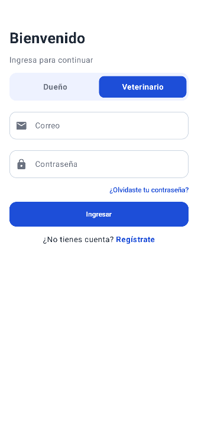 | 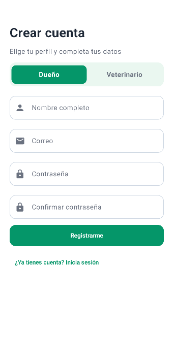 |

### Dueño

| Inicio | Ficha de la mascota | Pedir cita |
| --- | --- | --- |
| 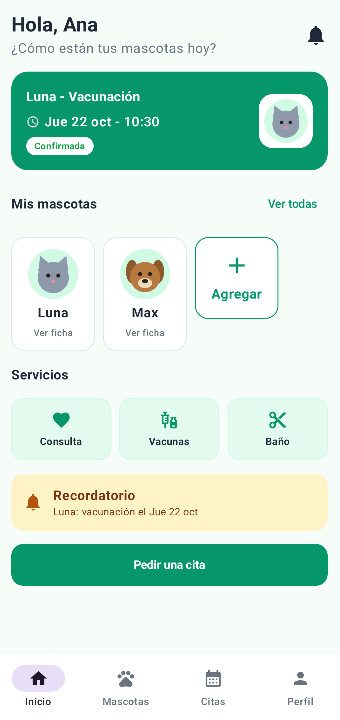 | 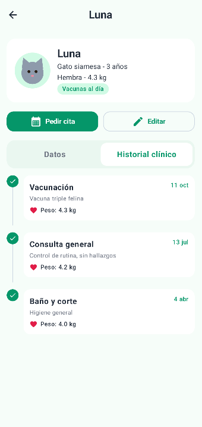 | 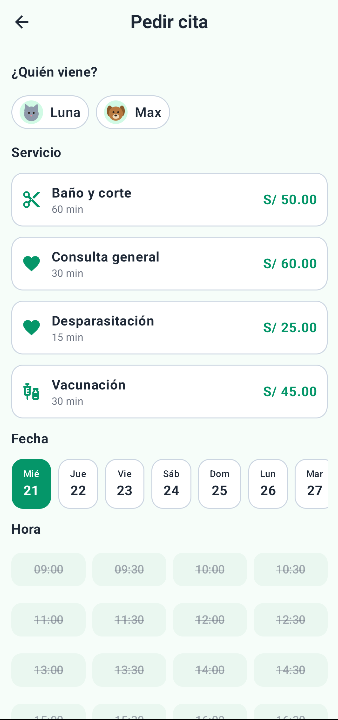 |

| Mis citas | Perfil |
| --- | --- |
| 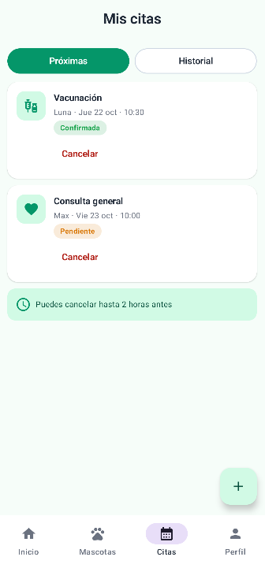 | 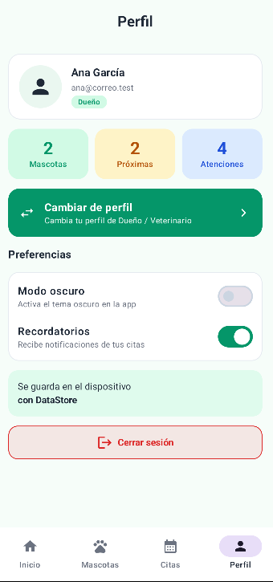 |

### Veterinario

| Panel | Agenda | Atender cita |
| --- | --- | --- |
| 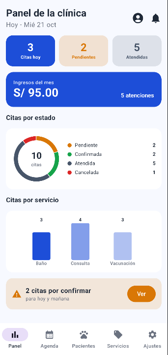 | 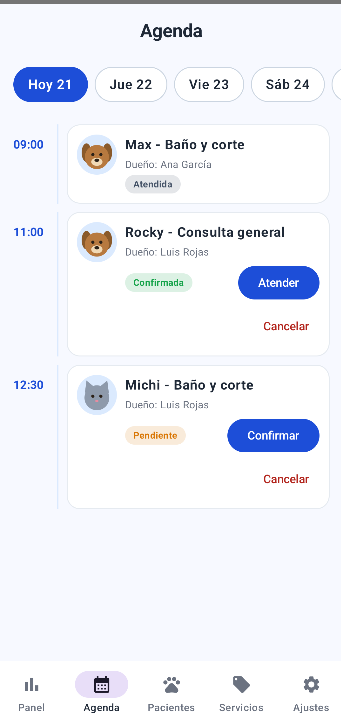 | 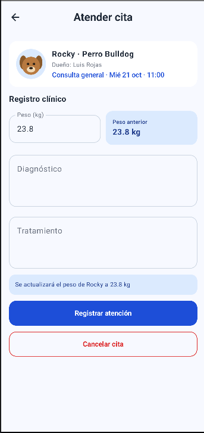 |

| Ajustes |
| --- |
| 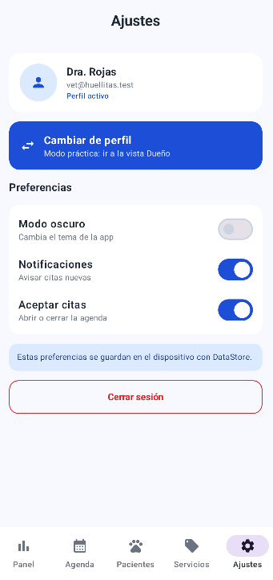 |

### Modo oscuro

| Pantalla en modo oscuro |
| --- |
| 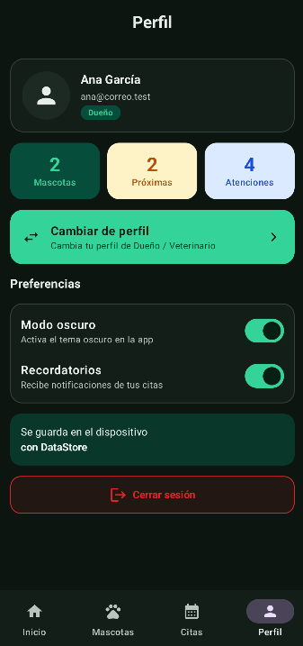 |

## FASE 2 - PROMPTS
### PROMPT - 1 
#### ROL
Actúa como un desarrollador Android senior experto en Kotlin, Jetpack Compose, Room y arquitectura MVVM + Repository.

#### CONTEXTO
Tengo la app "HuellitasVet" (paquete com.gutierrez.huellitasvet): Kotlin, Jetpack Compose, Material 3, MVVM, Room y un VetRepository (interface) con su implementación VetRepositoryRoom. Los archivos adjuntos son mi código actual. La ficha de la mascota (FichaMascotaScreen) tiene una pestaña "Historial clínico". Cada cita ATENDIDA guarda el peso en la columna pesoRegistrado. Ya existen GraficoDona y GraficoBarras en ui/components/graficos, pero no hay un gráfico de líneas.

#### TAREA
Agrega en la pestaña "Historial clínico" un gráfico de línea con el peso registrado en cada cita ATENDIDA de la mascota. Hazlo capa por capa, en este orden:
1. model/PuntoPeso.kt: data class PuntoPeso(val fecha: String, val peso: Double).
2. CitaDao: fun observarPesos(mascotaId: Int): Flow<List<PuntoPeso>> con @Query. Debe devolver fecha y pesoRegistrado (alias peso), solo de citas ATENDIDAS de esa mascota con peso no nulo, ordenadas por fecha y hora ascendente.
3. VetRepository (primero en la interface): fun observarPesos(mascotaId: Int): Flow<List<PuntoPeso>>. Después impleméntala en VetRepositoryRoom llamando al DAO.
4. MascotaViewModel: fun pesos(mascotaId: Int): StateFlow<List<DatoGrafico>>. Convierte cada PuntoPeso a DatoGrafico (etiqueta con Formato.fechaDiaMes, valor Float). Cachea el flujo por mascotaId, igual que ya se hace con historial().
5. ui/components/graficos/GraficoLineas.kt: composable GraficoLineas(datos: List<DatoGrafico>) dibujado con Canvas (línea, puntos y etiquetas) con colores de MaterialTheme. Si hay menos de 2 puntos, muestra el texto "Aún no hay suficientes datos".
6. FichaMascotaScreen: muestra el gráfico encima de la línea de tiempo. La View solo observa vm.pesos(id) y dibuja.

#### RESTRICCIONES
- La View no usa DAO ni Repository.
- El ViewModel solo conoce la interface VetRepository.
- Toda función nueva se declara primero en la interface.
- No modifiques ninguna entidad ni la versión de la base de datos.
- No uses XML ni librerías externas. Mantén el estilo y los nombres en español del código existente.

#### FORMATO DE SALIDA
Muéstrame solo los archivos que cambian o se crean, completos y con su ruta, listos para copiar. Al final, resume en 3 líneas qué hiciste en cada capa.

---

### PROMPT - 2
#### ROL
Actúa como un desarrollador Android senior experto en Kotlin, Jetpack Compose, Room y arquitectura MVVM + Repository.

#### CONTEXTO
Tengo la app "HuellitasVet" (paquete com.gutierrez.huellitasvet): Compose, Material 3, MVVM, Room y VetRepository como interface. Los archivos adjuntos son mi código actual. El dueño ya puede pedir citas (PedirCitaViewModel y PedirCitaScreen) y cancelarlas con la regla de 2 horas (MisCitasViewModel.puedeCancelar). Los horarios válidos son de 09:00 a 17:30 cada 30 minutos (Horarios.todos), y los días van de hoy a 7 días.

#### TAREA
Agrega "Reprogramar cita" para el dueño: puede cambiar la fecha y la hora de una cita PENDIENTE o CONFIRMADA. Reglas de negocio:
- Solo si la cita está PENDIENTE o CONFIRMADA.
- Solo si faltan MÁS de 2 horas para la cita actual.
- Solo con horarios libres, sin horas ya pasadas del día de hoy.

Hazlo capa por capa, en este orden:
1. CitaDao: suspend fun reprogramar(id: Int, fecha: String, hora: String) con un @Query UPDATE.
2. VetRepository (primero en la interface): suspend fun reprogramarCita(id: Int, fecha: String, hora: String): Boolean. En VetRepositoryRoom devuelve false si el nuevo horario ya está ocupado (verifícalo como lo hace crearCita) y true si actualizó.
3. ReprogramarCitaViewModel(repo, citaId): expone la cita (repo.observarCita), la fecha, la hora, las horasOcupadas (flatMapLatest sobre la fecha, como PedirCitaViewModel), un mensaje y confirmar(onListo). Las reglas de negocio viven aquí.
4. ReprogramarCitaScreen: reutiliza FechaChip y HoraChip y sigue el estilo de PedirCitaScreen. La View solo muestra y avisa.
5. MisCitasViewModel: agrega puedeReprogramar(cita). MisCitasScreen: botón "Reprogramar" en las citas próximas que cumplan la regla.
6. Rutas (REPROGRAMAR_CITA = "reprogramar_cita/{id}" y su función) y NavVet con VetViewModelFactory.

#### RESTRICCIONES
- La View no usa DAO ni Repository.
- El ViewModel solo conoce la interface VetRepository.
- Toda función nueva se declara primero en la interface.
- No modifiques entidades ni la versión de la base de datos.
- No uses XML ni librerías externas. Mantén el estilo y los nombres en español del código existente.

#### FORMATO DE SALIDA
Muéstrame solo los archivos que cambian o se crean, completos y con su ruta, listos para copiar. Al final, resume en 3 líneas qué hiciste en cada capa.