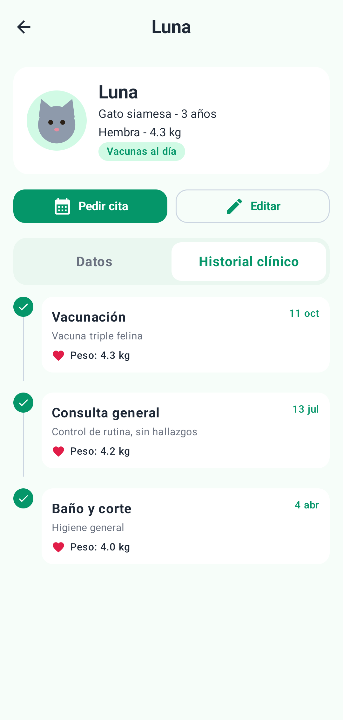
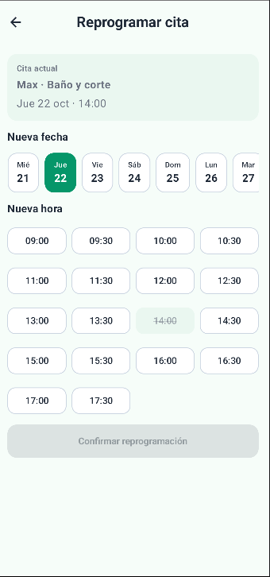
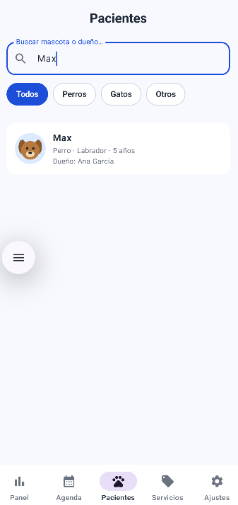
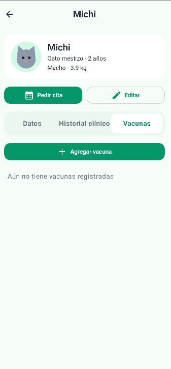
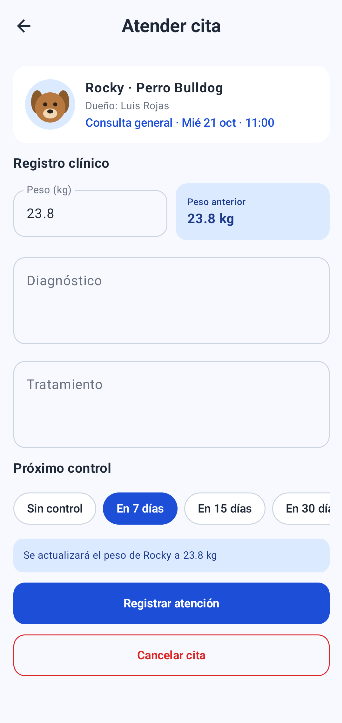
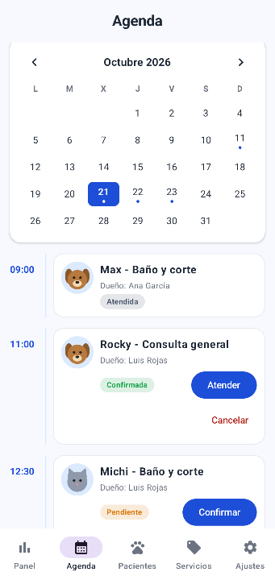

# HuellitasVet 

App móvil de una veterinaria con dos perfiles en el mismo dispositivo: el Dueño registra a sus mascotas, pide citas eligiendo servicio, fecha y hora, y consulta el historial clínico; el Veterinario ve la agenda, confirma citas, registra la atención (diagnóstico, tratamiento y peso), consulta a los pacientes y administra los servicios. Ambos perfiles comparten la misma base de datos Room: cuando el veterinario registra una atención, el dueño la ve al instante en el historial de su mascota.

## Base de datos (4 tablas)

| Tabla | Relación |
| --- | --- |
| `usuarios` | — |
| `servicios` | — |
| `mascotas` (FK → usuarios) | N mascotas → 1 dueño |
| `citas` (FK → mascotas, FK → servicios) | N citas → 1 mascota; N citas → 1 servicio |

## Estructura de paquetes

```
com.tecsup.huellitasvet
├── MainActivity.kt
├── VetApp.kt                     crea la base, el repository y las preferencias
├── data
│   ├── local
│   │   ├── entity   Servicio · Usuario · Mascota · Cita
│   │   ├── dao      ServicioDao · UsuarioDao · MascotaDao · CitaDao
│   │   ├── relation MascotaConDueno · CitaConDetalle
│   │   ├── VetDatabase.kt
│   │   └── DatosIniciales.kt
│   ├── repository   VetRepository (interface) · VetRepositoryRoom
│   └── prefs        PreferenciasStore (DataStore)
├── model            Enums · ConteoServicio · Horarios (+ Formato)
├── viewmodel        Sesion · Inicio · Mascota · PedirCita · MisCitas
│                    Panel · Agenda · AtenderCita · Pacientes · Servicios
└── ui
    ├── theme        Color · Type · Theme (VetTheme por rol)
    ├── components   AppTopBar · VetButton · VetTextField · EstadoCitaChip
    │                MascotaAvatar · CitaCard · FechaChip · HoraChip
    │                HistorialItem · OpcionChip · FilaSwitch · graficos/
    ├── navigation   Rutas · NavVet
    ├── dueno        Splash · Login · Inicio · Mascotas · FormularioMascota
    │                FichaMascota · PedirCita · MisCitas · Perfil
    └── veterinario  Panel · Agenda · AtenderCita · Pacientes
                     Servicios · FormularioServicio · Ajustes
```

## Capturas

### Acceso

| Inicio de sesión | Registro |
| --- | --- |
|  |  |

### Dueño

| Inicio | Ficha de la mascota | Pedir cita |
| --- | --- | --- |
|  |  |  |

| Mis citas | Perfil |
| --- | --- |
|  |  |

### Veterinario

| Panel | Agenda | Atender cita |
| --- | --- | --- |
|  |  |  |

| Ajustes |
| --- |
|  |

### Modo oscuro

| Pantalla en modo oscuro |
| --- |
|  |

## FASE 2 - PROMPTS
### PROMPT - 1 
#### ROL
Actúa como un desarrollador Android senior experto en Kotlin, Jetpack Compose, Room y arquitectura MVVM + Repository.

#### CONTEXTO
Tengo la app "HuellitasVet" (paquete com.gutierrez.huellitasvet): Kotlin, Jetpack Compose, Material 3, MVVM, Room y un VetRepository (interface) con su implementación VetRepositoryRoom. Los archivos adjuntos son mi código actual. La ficha de la mascota (FichaMascotaScreen) tiene una pestaña "Historial clínico". Cada cita ATENDIDA guarda el peso en la columna pesoRegistrado. Ya existen GraficoDona y GraficoBarras en ui/components/graficos, pero no hay un gráfico de líneas.

#### TAREA
Agrega en la pestaña "Historial clínico" un gráfico de línea con el peso registrado en cada cita ATENDIDA de la mascota. Hazlo capa por capa, en este orden:
1. model/PuntoPeso.kt: data class PuntoPeso(val fecha: String, val peso: Double).
2. CitaDao: fun observarPesos(mascotaId: Int): Flow<List<PuntoPeso>> con @Query. Debe devolver fecha y pesoRegistrado (alias peso), solo de citas ATENDIDAS de esa mascota con peso no nulo, ordenadas por fecha y hora ascendente.
3. VetRepository (primero en la interface): fun observarPesos(mascotaId: Int): Flow<List<PuntoPeso>>. Después impleméntala en VetRepositoryRoom llamando al DAO.
4. MascotaViewModel: fun pesos(mascotaId: Int): StateFlow<List<DatoGrafico>>. Convierte cada PuntoPeso a DatoGrafico (etiqueta con Formato.fechaDiaMes, valor Float). Cachea el flujo por mascotaId, igual que ya se hace con historial().
5. ui/components/graficos/GraficoLineas.kt: composable GraficoLineas(datos: List<DatoGrafico>) dibujado con Canvas (línea, puntos y etiquetas) con colores de MaterialTheme. Si hay menos de 2 puntos, muestra el texto "Aún no hay suficientes datos".
6. FichaMascotaScreen: muestra el gráfico encima de la línea de tiempo. La View solo observa vm.pesos(id) y dibuja.

#### RESTRICCIONES
- La View no usa DAO ni Repository.
- El ViewModel solo conoce la interface VetRepository.
- Toda función nueva se declara primero en la interface.
- No modifiques ninguna entidad ni la versión de la base de datos.
- No uses XML ni librerías externas. Mantén el estilo y los nombres en español del código existente.

#### FORMATO DE SALIDA
Muéstrame solo los archivos que cambian o se crean, completos y con su ruta, listos para copiar. Al final, resume en 3 líneas qué hiciste en cada capa.

---

### PROMPT - 2
#### ROL
Actúa como un desarrollador Android senior experto en Kotlin, Jetpack Compose, Room y arquitectura MVVM + Repository.

#### CONTEXTO
Tengo la app "HuellitasVet" (paquete com.gutierrez.huellitasvet): Compose, Material 3, MVVM, Room y VetRepository como interface. Los archivos adjuntos son mi código actual. El dueño ya puede pedir citas (PedirCitaViewModel y PedirCitaScreen) y cancelarlas con la regla de 2 horas (MisCitasViewModel.puedeCancelar). Los horarios válidos son de 09:00 a 17:30 cada 30 minutos (Horarios.todos), y los días van de hoy a 7 días.

#### TAREA
Agrega "Reprogramar cita" para el dueño: puede cambiar la fecha y la hora de una cita PENDIENTE o CONFIRMADA. Reglas de negocio:
- Solo si la cita está PENDIENTE o CONFIRMADA.
- Solo si faltan MÁS de 2 horas para la cita actual.
- Solo con horarios libres, sin horas ya pasadas del día de hoy.

Hazlo capa por capa, en este orden:
1. CitaDao: suspend fun reprogramar(id: Int, fecha: String, hora: String) con un @Query UPDATE.
2. VetRepository (primero en la interface): suspend fun reprogramarCita(id: Int, fecha: String, hora: String): Boolean. En VetRepositoryRoom devuelve false si el nuevo horario ya está ocupado (verifícalo como lo hace crearCita) y true si actualizó.
3. ReprogramarCitaViewModel(repo, citaId): expone la cita (repo.observarCita), la fecha, la hora, las horasOcupadas (flatMapLatest sobre la fecha, como PedirCitaViewModel), un mensaje y confirmar(onListo). Las reglas de negocio viven aquí.
4. ReprogramarCitaScreen: reutiliza FechaChip y HoraChip y sigue el estilo de PedirCitaScreen. La View solo muestra y avisa.
5. MisCitasViewModel: agrega puedeReprogramar(cita). MisCitasScreen: botón "Reprogramar" en las citas próximas que cumplan la regla.
6. Rutas (REPROGRAMAR_CITA = "reprogramar_cita/{id}" y su función) y NavVet con VetViewModelFactory.

#### RESTRICCIONES
- La View no usa DAO ni Repository.
- El ViewModel solo conoce la interface VetRepository.
- Toda función nueva se declara primero en la interface.
- No modifiques entidades ni la versión de la base de datos.
- No uses XML ni librerías externas. Mantén el estilo y los nombres en español del código existente.

#### FORMATO DE SALIDA
Muéstrame solo los archivos que cambian o se crean, completos y con su ruta, listos para copiar. Al final, resume en 3 líneas qué hiciste en cada capa.

---

### PROMPT - 3

#### ROL
Actúa como un desarrollador Android senior experto en Kotlin, Jetpack Compose, coroutines/Flow y arquitectura MVVM.

#### CONTEXTO
Tengo la app "HuellitasVet" (paquete com.gutierrez.huellitasvet): Compose, Material 3, MVVM, Room y VetRepository como interface. Los archivos adjuntos son mi código actual. La pantalla Pacientes del veterinario ya filtra por texto (nombre de mascota o de dueño) y por especie al mismo tiempo, usando combine en PacientesViewModel.

#### TAREA
Mejora la búsqueda de pacientes sin tocar el DAO ni el Repository:
1. La búsqueda ignora tildes y mayúsculas (java.text.Normalizer).
2. También busca por raza.
3. Espera 250 ms mientras el usuario escribe (debounce).
4. Los chips de especie muestran cuántos pacientes hay por especie, por ejemplo "Perro (2)". Expón los conteos como un StateFlow en el ViewModel.
5. Si no hay resultados, muestra un mensaje y un botón "Limpiar filtros" que llame a una función limpiar() del ViewModel.
   Toda la lógica va en PacientesViewModel y PacientesScreen solo muestra el estado.

#### RESTRICCIONES
- No modifiques el DAO, el Repository ni las entidades.
- La View no contiene lógica de filtrado.
- Mantén Compose + Material 3, sin XML ni librerías externas. Conserva el estilo y los nombres en español del código existente.

#### FORMATO DE SALIDA
Muéstrame solo los archivos que cambian, completos y con su ruta, listos para copiar. Al final, resume en 3 líneas qué cambió.

---
### PROMPT - 4
#### ROL
Actúa como un desarrollador Android senior experto en Kotlin, Jetpack Compose, Room y arquitectura MVVM + Repository.

#### CONTEXTO
Tengo la app "HuellitasVet" (paquete com.gutierrez.huellitasvet): Compose, Material 3, MVVM, Room y VetRepository como interface. Los archivos adjuntos son mi código actual. La base tiene 4 tablas (usuarios, servicios, mascotas, citas) y las fechas se guardan como texto 'aaaa-MM-dd'. La ficha de la mascota (FichaMascotaScreen) tiene las pestañas "Datos" e "Historial clínico" y recibe soloLectura = true cuando entra el veterinario.

#### TAREA
Agrega un carnet de vacunas visible en la ficha de la mascota. Hazlo capa por capa, en este orden:
1. Entidad data/local/entity/Vacuna.kt: id (autoGenerate), mascotaId (FK a Mascota con índice), nombre, fecha ('aaaa-MM-dd') y proximaDosis (String? opcional).
2. VacunaDao: insertar, eliminar y observarPorMascota(mascotaId): Flow<List<Vacuna>> ordenada por fecha descendente. Registra la entidad y el DAO en VetDatabase y SUBE el número de version en 1 respecto al actual.
3. VetRepository (primero en la interface): observarVacunas(mascotaId), guardarVacuna(v) y eliminarVacuna(v). Luego impleméntalas en VetRepositoryRoom. Además, eliminarMascota debe borrar antes las vacunas de esa mascota, dentro de una transacción, para no violar la llave foránea.
4. MascotaViewModel: vacunas(mascotaId): StateFlow<List<Vacuna>> (cacheado por mascotaId como historial()) y guardarVacuna(...) con estas validaciones en el ViewModel: nombre de mínimo 3 caracteres, fecha válida y no futura, y proximaDosis (si se escribe) válida y posterior a la fecha. Errores por campo en un StateFlow, como ya hace guardar() de mascota.
5. FichaMascotaScreen: nueva pestaña "Vacunas" con la lista (nombre, fecha, próxima dosis) y un botón "Agregar vacuna" que abre un diálogo con campos de texto. Si soloLectura es true, solo se ve la lista. La View solo muestra y llama al ViewModel.

#### RESTRICCIONES
- La View no usa DAO ni Repository.
- El ViewModel solo conoce la interface VetRepository.
- Toda función nueva se declara primero en la interface.
- Como cambia el esquema, la versión de la base debe subir (uso fallbackToDestructiveMigration).
- No uses XML ni librerías externas. Mantén el estilo y los nombres en español del código existente.

#### FORMATO DE SALIDA
Muéstrame solo los archivos que cambian o se crean, completos y con su ruta, listos para copiar. Al final, resume en 3 líneas qué hiciste en cada capa.

---

### PROMPT - 5

#### ROL
Actúa como un desarrollador Android senior experto en Kotlin, Jetpack Compose, Room y arquitectura MVVM + Repository.

#### CONTEXTO
Tengo la app "HuellitasVet" (paquete com.gutierrez.huellitasvet): Compose, Material 3, MVVM, Room y VetRepository como interface. Los archivos adjuntos son mi código actual. El veterinario atiende una cita en AtenderCitaScreen (diagnóstico, tratamiento y peso) y AtenderCitaViewModel llama a repo.registrarAtencion en una sola transacción. El dueño ve su pantalla InicioScreen, donde ya hay una tarjeta amarilla "Recordatorio" que hoy muestra la próxima cita. Las fechas se guardan como texto 'aaaa-MM-dd'.

#### TAREA
Al atender una cita, el veterinario puede fijar una fecha de próximo control, y el dueño la ve en su Inicio. Hazlo capa por capa, en este orden:
1. Entidad Cita: agrega la columna fechaControl: String? = null. SUBE el número de version de VetDatabase en 1 respecto al actual.
2. CitaDao: amplía el UPDATE de registrarAtencion con el parámetro fechaControl: String?.
3. VetRepository (primero en la interface): agrega fechaControl: String? a registrarAtencion y actualiza VetRepositoryRoom. Debe seguir siendo una sola transacción.
4. AtenderCitaViewModel.registrar: recibe fechaControl: String?. Regla en el ViewModel: si viene, debe ser posterior a hoy y a la fecha de la cita; si no, error en el campo "control".
5. AtenderCitaScreen: agrega opciones con OpcionChip: "Sin control", "En 7 días", "En 15 días" y "En 30 días". La View solo convierte la opción a una fecha y se la pasa al ViewModel.
6. InicioViewModel: nuevo StateFlow proximoControl con el control futuro más cercano de las citas ATENDIDAS de las mascotas del dueño (calculado en el ViewModel a partir de observarCitasDeDueno, sin tocar el DAO).
7. InicioScreen: si hay proximoControl, la tarjeta "Recordatorio" muestra "Control de <mascota>: <fecha>"; si no, conserva el comportamiento actual.

#### RESTRICCIONES
- La View no usa DAO ni Repository.
- El ViewModel solo conoce la interface VetRepository.
- Toda función nueva o modificada se declara primero en la interface.
- Como cambia una entidad, la versión de la base debe subir (uso fallbackToDestructiveMigration).
- No uses XML ni librerías externas. Mantén el estilo y los nombres en español del código existente.

#### FORMATO DE SALIDA
Muéstrame solo los archivos que cambian, completos y con su ruta, listos para copiar. Al final, resume en 3 líneas qué hiciste en cada capa.

---

### PROMPT - 6

#### ROL
Actúa como un desarrollador Android senior experto en Kotlin, Jetpack Compose, coroutines/Flow y arquitectura MVVM + Repository.

#### CONTEXTO
Tengo la app "HuellitasVet" (paquete com.gutierrez.huellitasvet): Compose, Material 3, MVVM, Room y VetRepository como interface. Los archivos adjuntos son mi código actual. La agenda del veterinario (AgendaScreen) muestra chips de los próximos 7 días y la lista de citas del día elegido; AgendaViewModel tiene fechaSeleccionada y citas con flatMapLatest. Las fechas se guardan como texto 'aaaa-MM-dd'.

#### TAREA
Agrega una vista de mes en la agenda, con un punto en los días que tienen citas. Hazlo capa por capa, en este orden:
1. CitaDao: fun observarDiasConCitas(inicio: String, fin: String): Flow<List<String>> con un SELECT DISTINCT fecha de las citas no CANCELADAS entre esas fechas (BETWEEN).
2. VetRepository (primero en la interface): observarDiasConCitas(inicio: String, fin: String): Flow<List<String>>. Luego impleméntala en VetRepositoryRoom.
3. AgendaViewModel: StateFlow del mes visible (YearMonth), funciones mesAnterior() y mesSiguiente(), un StateFlow diasConCitas (Set<LocalDate>) que cambie con el mes usando flatMapLatest, y la lista de celdas del mes (con los espacios vacíos iniciales para empezar en lunes). Al tocar un día se reutiliza seleccionar(fecha), de modo que la lista de citas de abajo sigue funcionando.
4. ui/components/CalendarioMes.kt: composable con encabezado "octubre 2026" y flechas para cambiar de mes, letras de los días (L M X J V S D), el día seleccionado resaltado y un punto bajo los días con citas. Recibe todo por parámetros y no conoce el ViewModel.
5. AgendaScreen: reemplaza los chips por el calendario y mantén la lista de citas del día elegido debajo.

#### RESTRICCIONES
- La View no usa DAO ni Repository.
- El ViewModel solo conoce la interface VetRepository.
- Toda función nueva se declara primero en la interface.
- No modifiques entidades ni la versión de la base de datos.
- No uses XML ni librerías externas. Mantén el estilo y los nombres en español del código existente.

#### FORMATO DE SALIDA
Muéstrame solo los archivos que cambian o se crean, completos y con su ruta, listos para copiar. Al final, resume en 3 líneas qué hiciste en cada capa.

## Capturas Fase 2

| Gráfico de peso | Reprogramar cita | Búsqueda de pacientes |
| --- | --- | --- |
|  |  |  |

| Carnet de vacunas | Recordatorio de próximo control | Calendario mensual |
| --- | --- | --- |
|  |  |  |
