# Catálogo de Productos

Aplicación Android de catálogo de productos hecha con Kotlin y Jetpack Compose (MVVM). Consume la API de [dummyjson.com](https://dummyjson.com), guarda los datos con Room para usarlos sin conexión, inicia sesión y registra usuarios con Firebase, maneja los roles USUARIO y ADMIN, permite marcar favoritos, agregar productos al carrito, ordenar y filtrar la lista, y muestra una notificación local al sincronizar desde el panel Admin.

## Capturas

| Login | Registro | Lista |
|:---:|:---:|:---:|
| 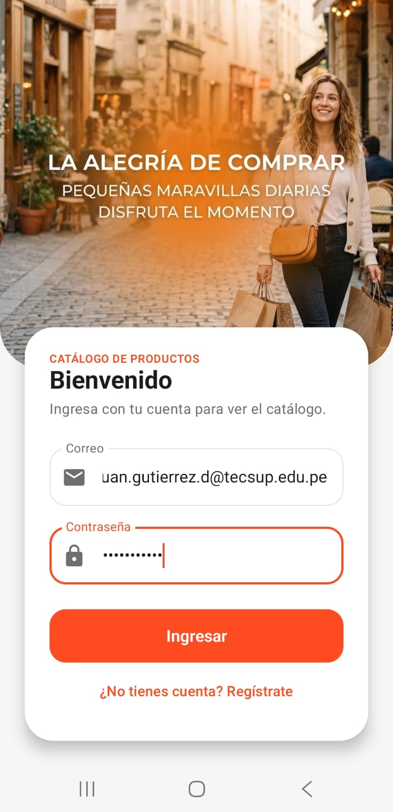 | 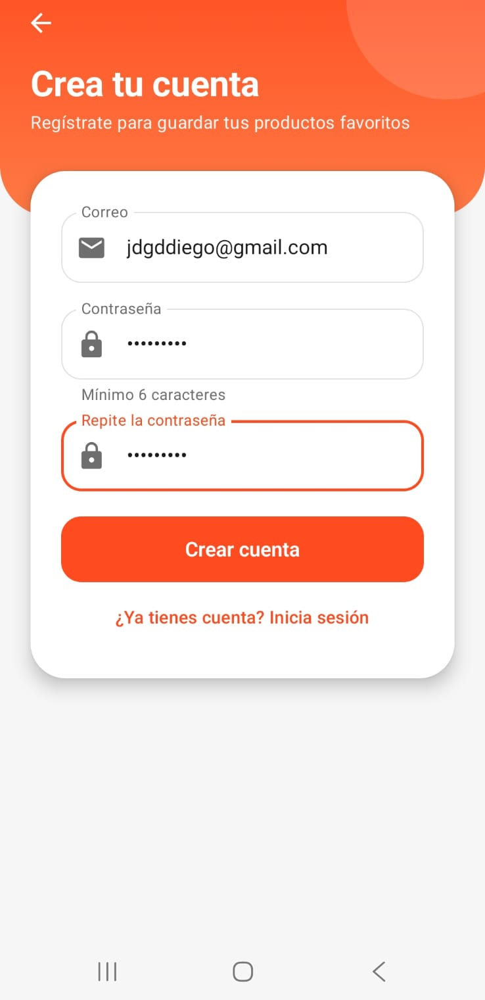 | 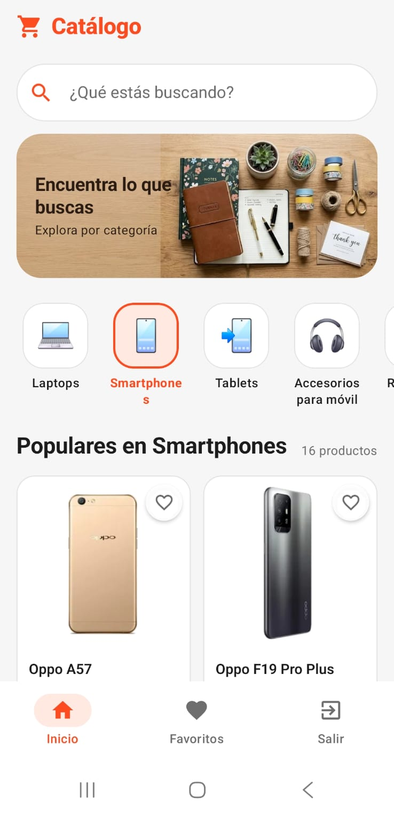 |

| Búsqueda | Ordenar y filtrar | Detalle |
|:---:|:---:|:---:|
| 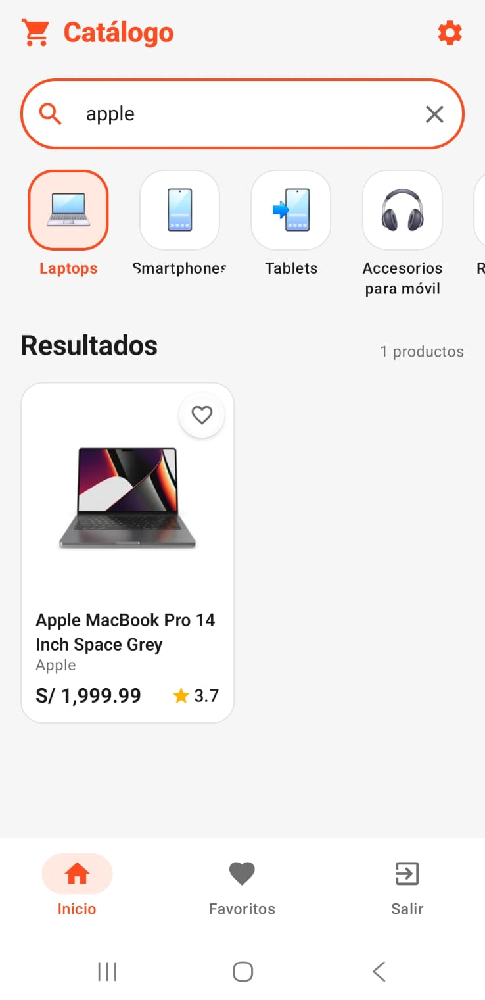 | 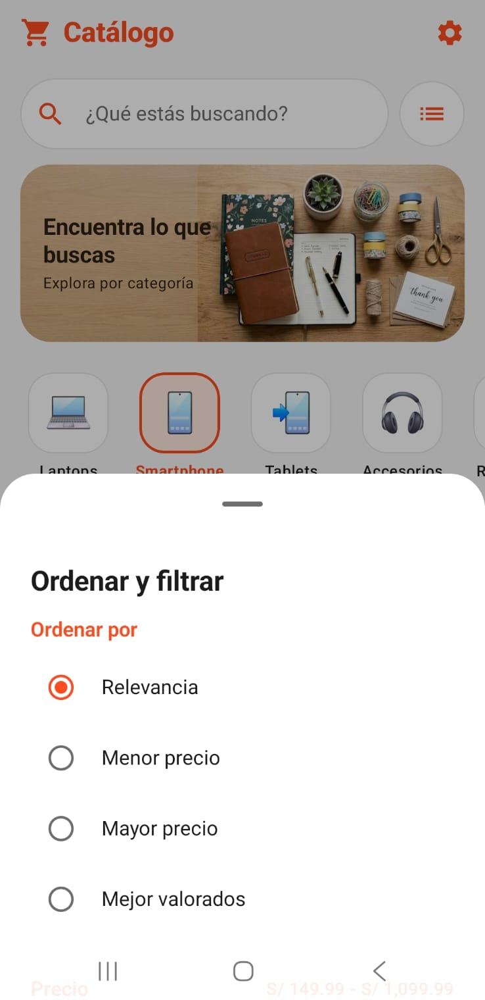 | 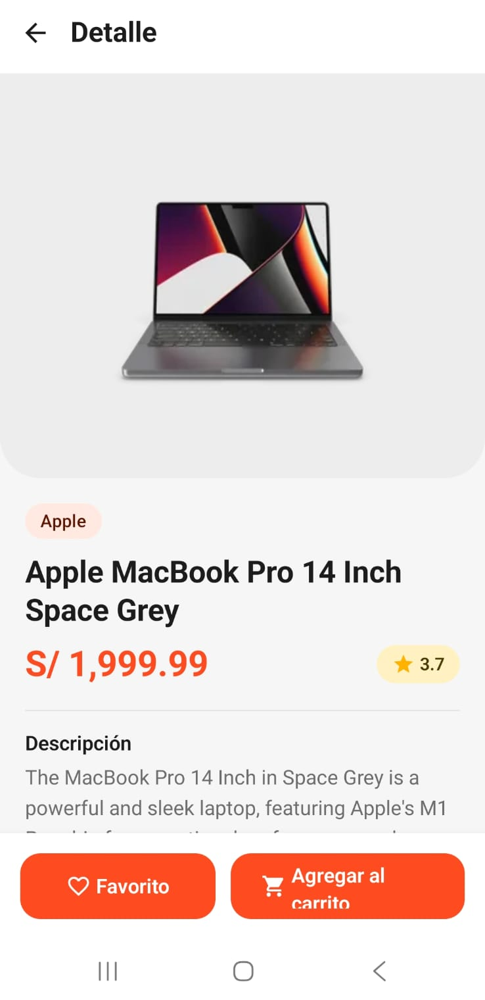 |

| Favoritos | Carrito | Panel Admin |
|:---:|:---:|:---:|
| 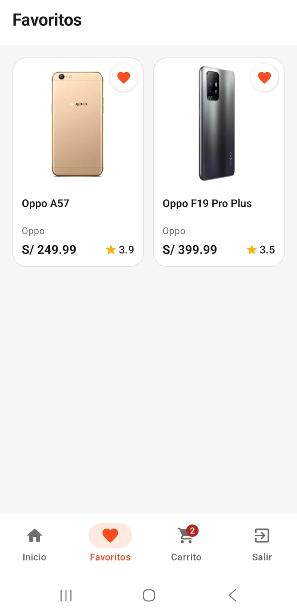 | 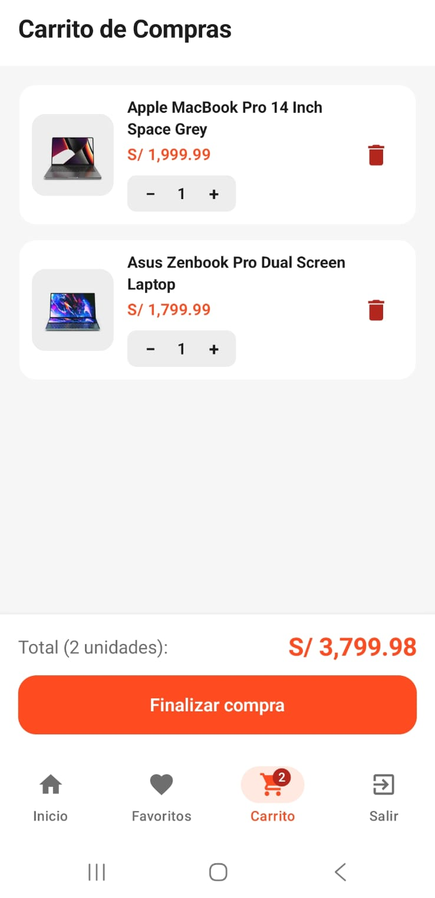 | 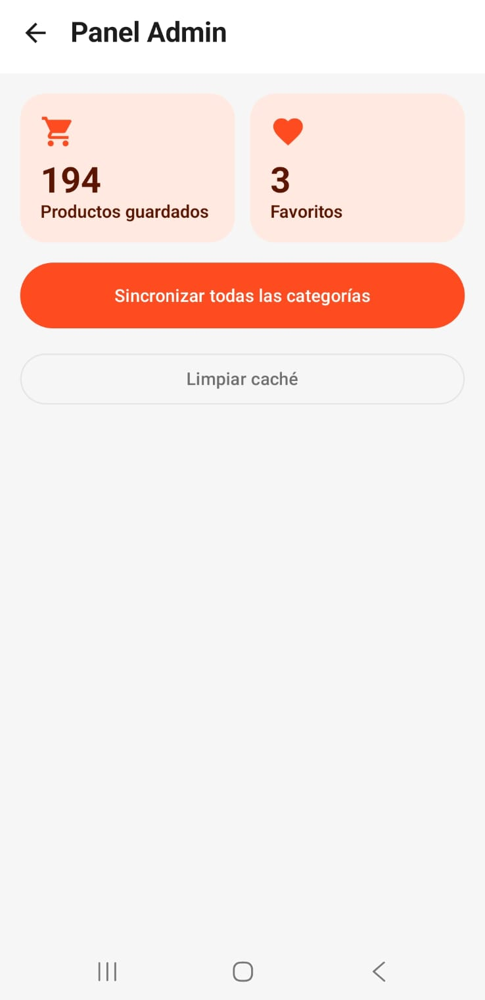 |

| Sin conexión | Notificación |
|:---:|:---:|
| 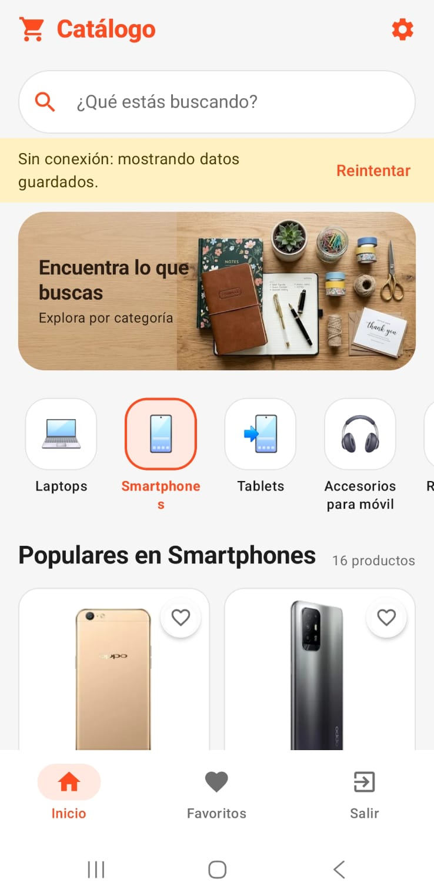 | 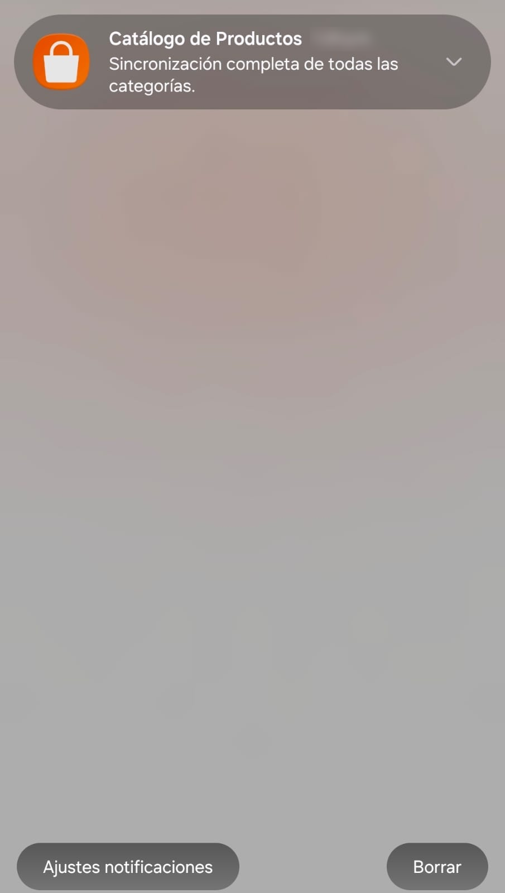 |
