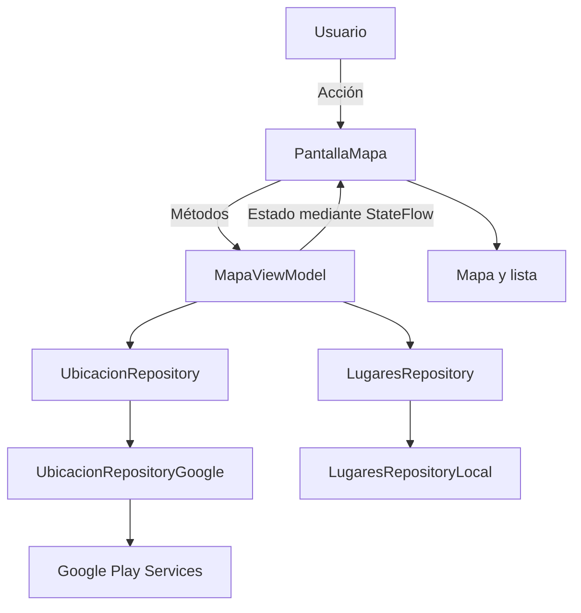
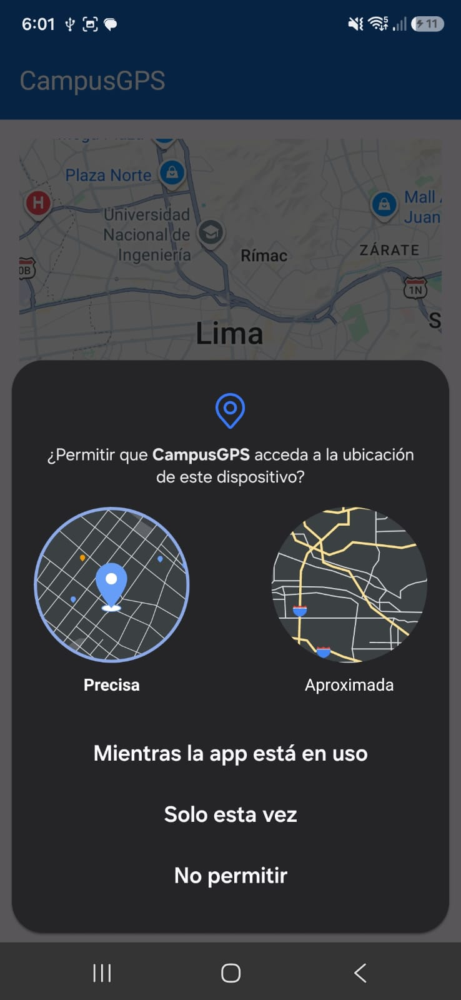
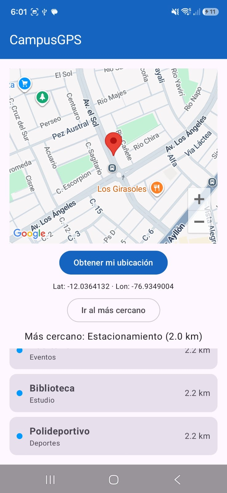
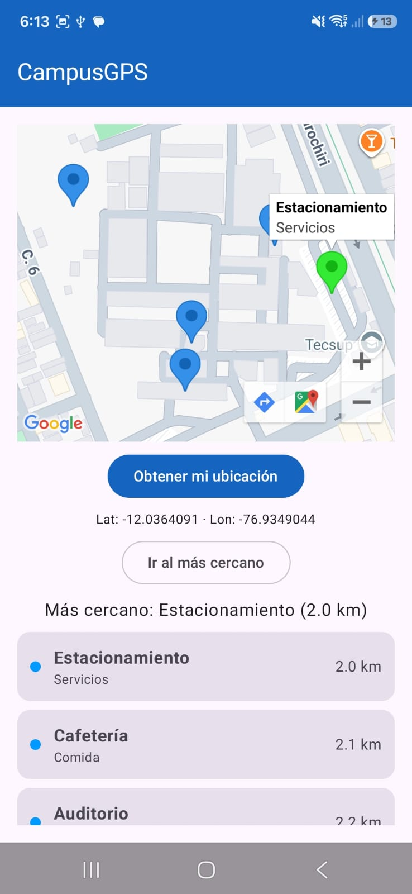
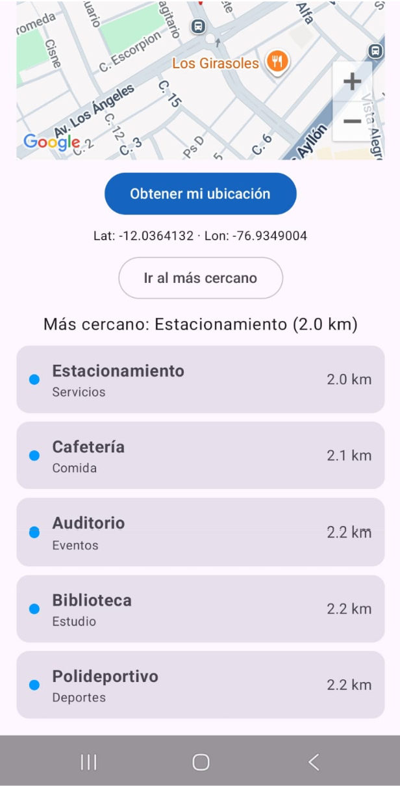
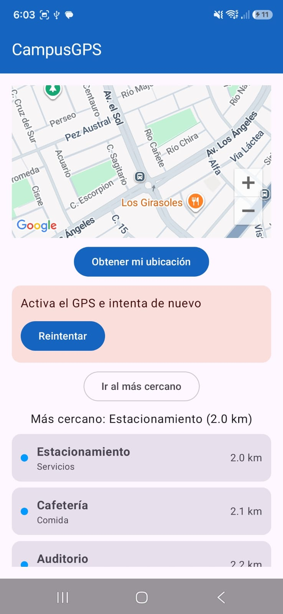

# CampusGPS
**App que obtiene la ubicación del celular, la muestra en un mapa y te dice qué
lugar del campus tienes más cerca.**

Puntos ficticios: biblioteca, cafetería, polideportivo, auditorio y estacionamiento.
La app debe seguir funcionando aunque el usuario niegue el permiso, apague el GPS o no tenga Google Play Services.

---
### Cordenadas
**Biblioteca:** -12.045124069368782, -76.95285201895858

**Auditorio:** -12.044772269913807, -76.95280431691197

**Cafeteria:** -12.044062871724222, -76.95218310894187

**Polideportivo:** -12.043776332646424, -76.95368754644164

**Aparcamiento:** -12.044412683818752, -76.95175670825616

### Estructura
```text
com.gutierrez.campusgps/
├── MainActivity.kt
├── model/
│   └── Modelos.kt
├── data/
│   ├── UbicacionRepository.kt
│   ├── UbicacionRepositoryGoogle.kt
│   ├── LugaresRepository.kt
│   └── LugaresRepositoryLocal.kt
├── util/
│   ├── Distancia.kt
│   └── Formato.kt
├── viewmodel/
│   ├── MapaViewModel.kt
│   └── CampusViewModelFactory.kt
└── ui/
    ├── PantallaMapa.kt
    ├── MapaUbicacion.kt
    ├── ListaLugares.kt
    ├── MensajeError.kt
    └── theme/
```

### Arquitectura y flujo


### Para pensar
1. **¿Por qué FusedLocationProviderClient está dentro del Repository y no en el ViewModel?**

    Lo puse en el Repository porque esa clase se encarga de obtener la ubicación del celular. El ViewModel solo necesita pedir una posición y trabajar con el resultado, sin conocer cómo Google la obtiene. Así mantengo las responsabilidades separadas y puedo probar el ViewModel con una ubicación simulada.

2. **¿Qué diferencia hay entre el permiso de ubicación y la clave de API de Maps? ¿Qué pasa si falta cada uno?**

    El permiso de ubicación es la autorización que da el usuario para que la app pueda consultar dónde está su celular. La clave de API permite que mi aplicación utilice el servicio de Google Maps.

    Si el usuario no concede el permiso, no puedo mostrar su ubicación ni calcular las distancias desde ella, pero sí puedo mostrar los lugares del campus. Si falta la clave o está mal configurada, el mapa puede aparecer vacío o no cargar correctamente.

3. **¿Por qué la clave va en local.properties y no en el código? ¿Qué harías si se subiera a GitHub por error?**

    La guardo en local.properties porque ese archivo está excluido de Git y así evito publicar la clave junto con el código. Además, la restrinjo para que solo se pueda utilizar con mi aplicación y su certificado.

    Si la subiera por error, no bastaría con borrarla del archivo, porque podría seguir en el historial de Git. Tendría que revocarla, generar otra y revisar cómo se publicó para evitar que vuelva a pasar.

4. **¿Dónde calculas la distancia y por qué no en el Composable?**

    El cálculo está en la función distanciaMetros, dentro de util/Distancia.kt. El ViewModel la llama cuando recibe la ubicación y después ordena los lugares del más cercano al más lejano.

    No lo hago en el Composable porque la pantalla debe encargarse de mostrar los resultados. De esa manera, el cálculo queda separado del diseño y no depende de cuántas veces se actualice la interfaz.

5. **¿Qué pasa con tu app si el usuario niega el permiso dos veces? ¿Cómo lo manejas?**

    Después de rechazarlo varias veces, Android puede dejar de mostrar la ventana para pedir permiso. En ese caso, la app sigue abierta y muestra un mensaje con el botón Abrir ajustes, para que el usuario pueda concederlo manualmente.

    Cuando regresa y pulsa Obtener mi ubicación, vuelvo a comprobar el permiso. Si ya lo concedió, la app continúa con la búsqueda.

---

### Capturas
| Permiso                                  | Mapa con mi ubicación                            | Marcadores                                  | Lista ordenada                                 | Error                                  |
|------------------------------------------|--------------------------------------------------|---------------------------------------------|------------------------------------------------|----------------------------------------|
|  |  |  |  |  |

