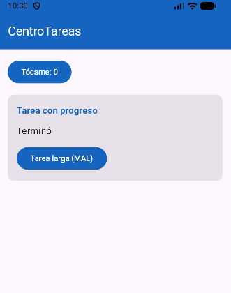
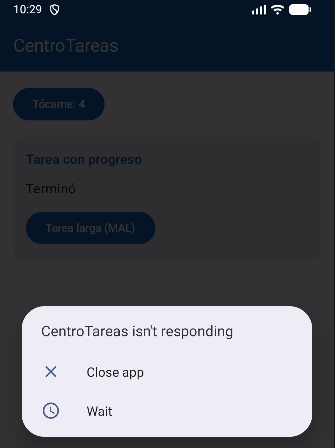
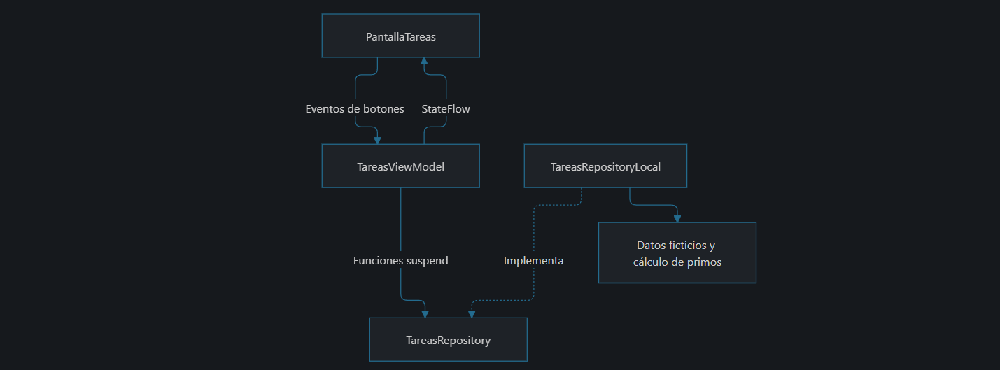
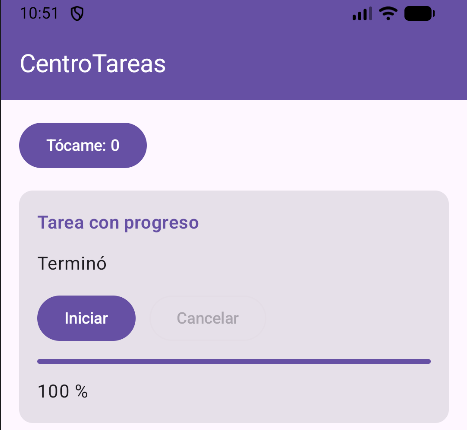
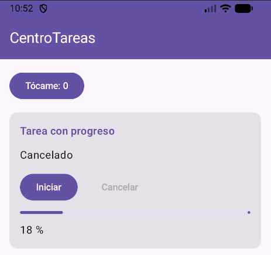
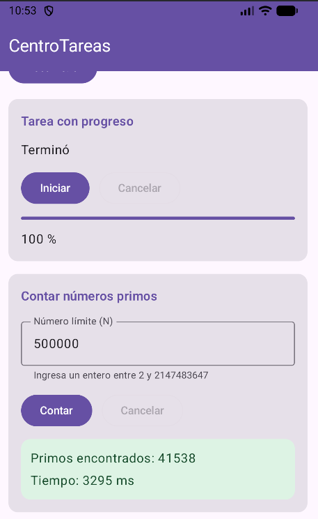
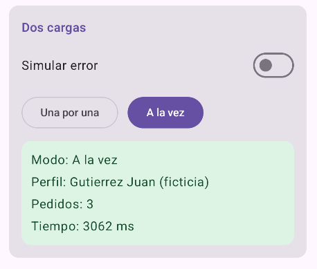
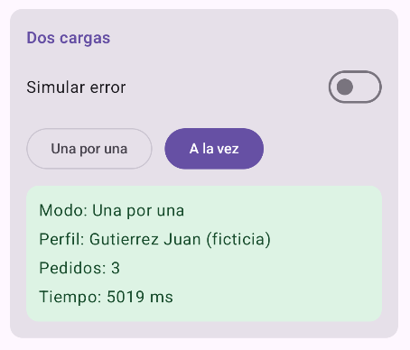
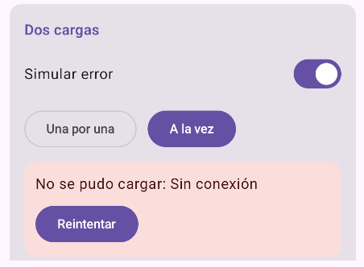

# CentroTareas
**App que hace tres cosas que tardan: una tarea con barra de progreso, un
cálculo pesado (contar números primos) y dos cargas de datos simuladas.**

- El **hilo principal** dibuja la pantalla y atiende los toques. **Nunca** se bloquea.
- Todo lo que tarde (red, disco, cálculos) se hace en **segundo plano** con corrutinas, y el resultado vuelve al hilo principal.
- Toda tarea larga debe poder **cancelarse** y debe **mostrar su estado**: cargando, éxito o error.
  Usa solo datos ficticios.
---

## Estructura de paquetes
```text
com.gutierrez.centrotareas/
├── MainActivity.kt
├── model/
│   └── Estados.kt
├── data/
│   ├── TareasRepository.kt
│   └── TareasRepositoryLocal.kt
├── viewmodel/
│   ├── TareasViewModel.kt
│   └── TareasViewModelFactory.kt
└── ui/
    ├── PantallaTareas.kt
    └── theme/
        ├── Color.kt
        ├── Theme.kt
        └── Type.kt 
```
### Observación del Paso 1: 
Al pulsar el boton "Tarea larga (MAL)", la pantalla dejó de responder durante cuatro segundos y el contador "Tócame" no se actualizaba. El mensaje "Trabajando..." no llegó a mostrarse; al finalizar apareció "Terminó". Esto es porque Thread.sleep(4000) bloqueó el hilo principal, lo cual impide actualizar la pantalla y atender los toques. Si el bloqueo durara diez segundos, Android mostrará un aviso de que la aplicación no responde.

| Thread.sleep(4000)                             | Thread.sleep(10000)                             |
|------------------------------------------------|-------------------------------------------------|
|  |  |

---
## Arquitectura MVVM + Repository
 
---

| Evidencia | Imagen                                                                                                       |
|---|--------------------------------------------------------------------------------------------------------------|
| 1. Tarea con progreso |                                                                  |
| 2. Tarea cancelada |                                                              |
| 3. Conteo de primos |                                                                 |
| 4. Comparación de cargas | |
| 5. Error simulado |                                                                  |
